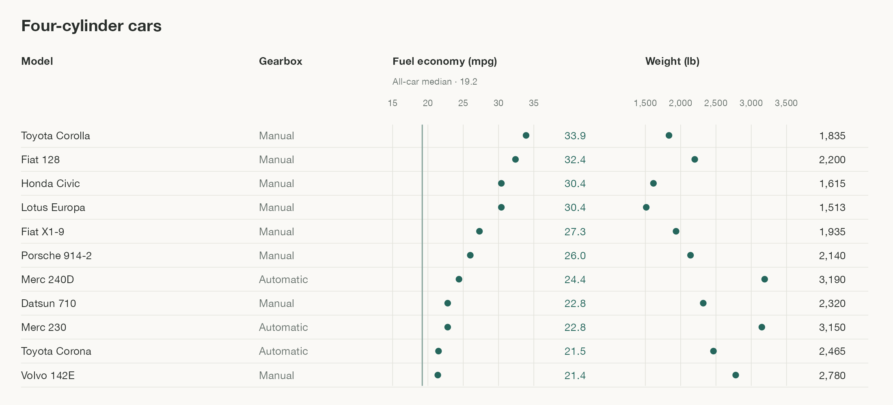

# Worked comparison

Read this example when comparing named observations with several relevant measurements and contextual fields. Open the [rendered chart](aligned-comparison.png) to inspect the alignment, spacing, and visual hierarchy at its intended reading size.



## Data and question

How do the four-cylinder cars in a set of road tests compare in fuel economy and weight, and how does their fuel economy compare with the whole set?

The example uses all 11 four-cylinder cars in R's built-in `datasets::mtcars`, ordered by descending fuel economy. Model names remain intact. `mpg` measures miles per US gallon, `wt` becomes pounds through multiplication by 1,000, and `am` identifies automatic or manual transmission. The [R dataset documentation](https://stat.ethz.ch/R-manual/R-patched/library/datasets/html/mtcars.html) describes the 32 road tests and their field definitions.

The vertical reference is the median fuel economy computed from all 32 cars. Its label identifies that comparison population. It is a descriptive benchmark for these road tests.

## Design decisions

| Choice | Purpose |
| --- | --- |
| One shared row per model | Connect identity, context, and both measurements without repeated lookup |
| Descending fuel economy | Reveal rank while keeping each car's weight and gearbox attached |
| A text column for gearbox | Preserve a recurring qualifier without another symbol to decode |
| Separate quantitative scales | Compare each measure accurately in its own units |
| Dots beside exact numerical values | Support distribution reading and precise lookup together |
| A labeled all-car median | Put the broader comparison inside the graphic |
| Warm near-white background, quiet rules, and compact type | Keep labels and data prominent while supporting row tracking |

The arrangement keeps individual cars distinguishable even when their values coincide. Both measurements remain visible together, so another panel is useful only when it exposes a relationship this view obscures. The colors and column widths illustrate a hierarchy. Choose scales, spacing, and fields for the actual data and destination.

## Reproduce

The [R source](../scripts/render-aligned-comparison.R) uses base R, ggplot2, and ragg. From the skill directory:

```sh
Rscript scripts/render-aligned-comparison.R
```

The default output is `references/aligned-comparison.png`, resolved relative to the script. An optional output path lets the same example render into a scratch directory:

```sh
Rscript scripts/render-aligned-comparison.R /tmp/aligned-comparison.png
```
